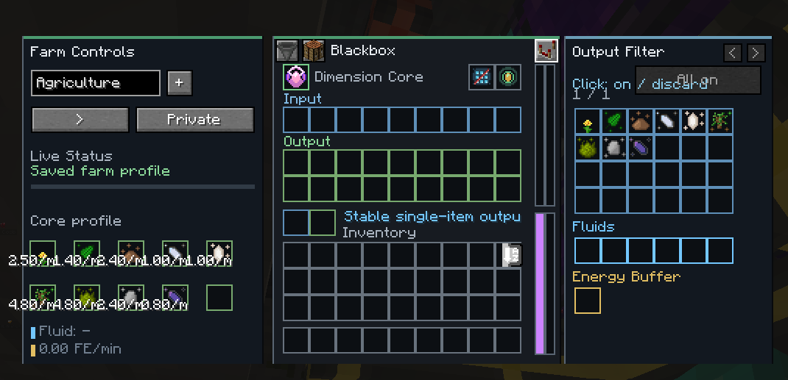
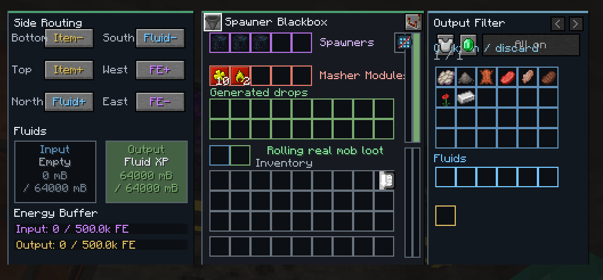
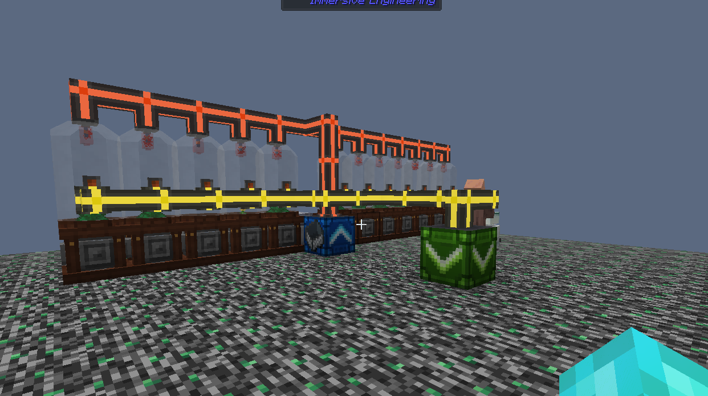

# BlackBox

BlackBox is a NeoForge mod that records an automated farm once, then replays its measured net production from a compact machine while the original farm stays unloaded.

> **Status:** Playable work in progress. Please test exploits. 

## Screenshots

  
  
  

## Features

- Build farms in isolated, configurable 1x1, 2x2, or 3x3 chunk cells.
- Measure net item, fluid, FE, and persistent-mob changes after leaving the farm.
- Run saved cores in a Blackbox with sided item, fluid, and FE routing.
- Replay recorded output peaks, or smooth them with a Stability Upgrade.
- Filter outputs per Blackbox without changing the core.
- Store farm Blueprints and use optional Spawner Blackboxes for compatible modpacks.

## Quick Start

1. Place a Blackbox, insert an empty Dimension Core, and name the farm.
2. Apply cell-size, environment, or mob-spawn upgrades at an Anvil.
3. Enter the cell, build the farm, and connect it with Farm Input and Farm Output blocks.
4. Leave through Dimensional Bedrock to record production.
5. Insert the programmed core into any Blackbox to replay the result.

A video tutorial will be linked here when it is ready.

## Compatibility

| Minecraft | Loader | Java |
| --- | --- | --- |
| 1.21.1 | NeoForge 21.1.190 or newer | 21 |

## Contributing

Bug reports, ideas, and pull requests are welcome.

## License

BlackBox is licensed under the [MIT License](LICENSE).
